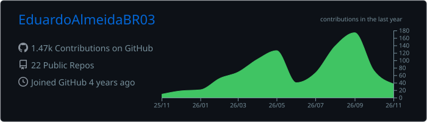
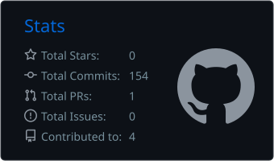
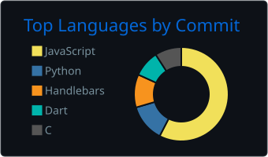

# Olá, eu sou o Eduardo Almeida 👋

## 🧑‍💻 Sobre mim

Desenvolvedor backend de Cachoeiro de Itapemirim (ES). Construo APIs escaláveis e cuido da infraestrutura que as mantém de pé, do banco de dados até a rede.

- 💼 **Backend Developer na TelcoWeb**: APIs em Elixir (Phoenix) e Python, modelagem de PostgreSQL, redes Linux (roteamento, namespaces, VPN), SDN e firewall
- 🏗️ **Full Stack & Infra no Hub Distrito 28**: site e portal do hub, deploys automatizados e CI/CD com GitHub Actions (self-hosted runners)
- 🤖 Modelos de Machine Learning com Pandas e NumPy, e agentes de IA no dia a dia de desenvolvimento
- 🔭 Interesses atuais: automação em cloud, integrações de IA (Ollama, LiteLLM) e arquitetura de redes
- 🎓 Sistemas de Informação no IFES, onde também fui monitor de desenvolvimento web no projeto Reprograme-se

## 🛠️ Stack

**Linguagens**

**Backend e dados** · Phoenix, Ecto, Node.js, Express, GraphQL, PostgreSQL, Pandas, NumPy

**Infraestrutura e DevOps**

**Frontend e mobile**

## 💼 Experiência

| Período | Empresa | Função |
|---|---|---|
| abr/2026 – hoje | Hub Distrito 28 | Full Stack Developer & Infrastructure Analyst |
| abr/2024 – hoje | TelcoWeb | Backend Developer |
| abr/2023 – mai/2024 | IFES · Reprograme-se | Monitor de Desenvolvimento Web |

## 🚀 Projetos em destaque

| Projeto | Descrição | Stack |
|---|---|---|
| <!-- um projeto de API/backend seu --> | <!-- 1 frase: o que faz --> | <!-- ex.: Elixir · Phoenix · PostgreSQL --> |
| [Lava-Jato Flutter](https://github.com/EduardoAlmeidaBR03/Lava-Jato-Flutter-) | <!-- 1 frase: o que o app faz e para quem --> | Flutter · Dart |
| [Movimentação Bancária em C](https://github.com/EduardoAlmeidaBR03/Movimenta-o-Banc-ria-em-C) | Controle de transações de uma conta bancária usando arquivos binários | C |

## 📊 Estatísticas

  

  
  

## 📫 Contato

  
  
  
  

  <picture>
    <source media="(prefers-color-scheme: dark)" srcset="https://raw.githubusercontent.com/EduardoAlmeidaBR03/EduardoAlmeidaBR03/output/github-snake-dark.svg" />
    
  </picture>

